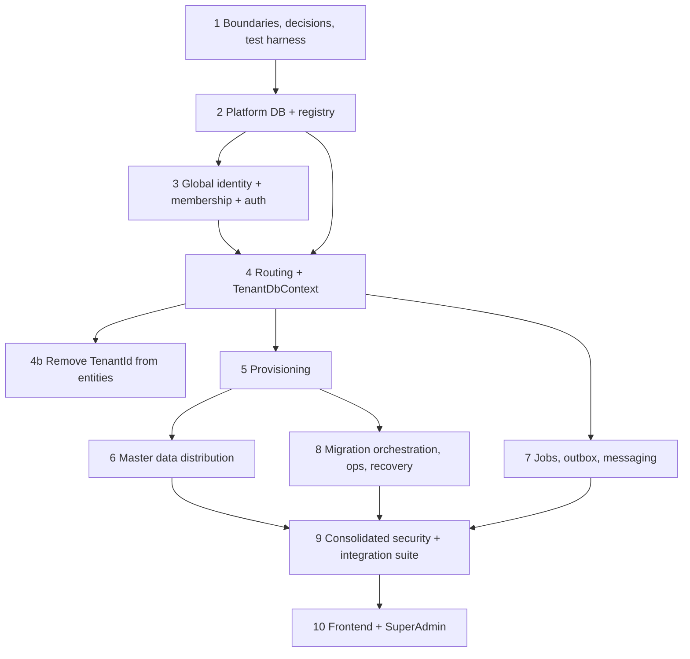

# Multi-Tenant Redesign: Implementation Roadmap

Status: **plan for review. Nothing in this roadmap has been started.** Implementation begins only after the approval gates below.
Read first: `multi-tenant-database-redesign.md` (architecture and decisions D-01 to D-19), `master-data-redesign.md` (catalogs).

---

## 0. Ground rules

- Backend and database work is permitted for this effort only, under the scoped amendment in `CLAUDE.md`. All other `CLAUDE.md` rules still apply: existing architecture, no new demo project, no `npm install`/build/test runs unless the owner asks, do not restart the dev server.
- **No migration is generated or applied, and no database is created, altered or dropped, without the approval gate of the phase that needs it.** Tests that need PostgreSQL run against disposable containers, never against the development database.
- Each phase ends with: code, tests (written with the phase, not after), updated docs, a short written report, and an **approval gate**. The next phase does not start until the gate is passed.
- Size estimates are relative (S, M, L, XL), not calendar promises.
- The product has no production tenants, so phases may change schemas by regenerating baselines instead of writing backfill migrations.

## 1. Dependency overview

Reordering from the earlier sketch, and why:
- **Platform DB comes before identity**: `UserIdentity` and `TenantMembership` live in the Platform DB.
- **Hospital selection in login is finished in phase 4**: validating a hospital assignment needs the tenant database, so phase 3 delivers tenant-level context and phase 4 adds the hospital step.
- Phases 6, 7 and 8 can proceed in parallel after phase 5 only if they touch different projects and different tables (see each phase's "parallel-safe" line).
- Test work is spread across phases; phase 9 consolidates and gates.

### Transitional "compatibility mode" (phases 2 to 4)

To keep the application runnable and reviewable, the registry initially points every tenant at the single existing development database and the tenant query filter stays on. This is **development only** and ends at phase 4b. It is a conscious, temporary weakness, not the target. (Alternative: a single big-bang cutover; rejected because it is harder to review and to roll back.)

---

## 2. Approval gates

| Gate | Passed when |
|---|---|
| **G0 Design approved** | Owner reviews the three documents; decisions D-01 to D-19 accepted or changed; open questions in `multi-tenant-database-redesign.md` §14 answered or defaulted. |
| **G1 to G10** | One per phase: owner reviews the phase report, test results and the acceptance checklist. |
| **GDB Database operations** | Separate explicit approval before any phase that generates a migration, creates databases or touches a non-container database (phases 2, 4b, 5, 8). |
| **GHost Hosting selected** | Required before any provider-specific provisioner, secret store or backup tooling (phases 5 and 8). Provider-neutral work does not wait. |

---

## 3. Phases

### Phase 1: Boundaries, decisions and test harness (S to M)

**Goal.** Freeze the vocabulary and prove we can test against real PostgreSQL before changing structure.
**Depends on.** G0.
**Work**
- Record accepted decisions in the architecture document (status column).
- Create `PhysioBoo.IntegrationTests` (xUnit) with a Testcontainers PostgreSQL fixture able to start two or more databases on one container. Reuse conventions of `PhysioBoo.Application.Test` (`CommandHandlerFixtureBase`).
- Architecture tests (NetArchTest or equivalent): `ApplicationDbContext`/tenant context not injectable into singletons or `BackgroundService`; no `IgnoreQueryFilters` outside an allow-list.
- Optional quick fix needing approval: remove forced `EnableSensitiveDataLogging(true)` from `ApplicationDbContext.OnConfiguring` (finding S1).
- Add a CI pipeline file that builds and runs unit and architecture tests (CI is absent today).
**Code areas.** new `physio-server/PhysioBoo.IntegrationTests/**`, `physio-server.sln`, pipeline file, `ApplicationDbContext.cs` (S1 only).
**Tests.** Fixture self-test: two databases on one container, schema applied to each, isolated.
**Acceptance**
- Two empty tenant-shaped databases can be created and destroyed by tests with no dependency on the development database.
- Architecture tests fail when a hosted service takes the tenant DbContext.
- Owner has signed D-01 to D-19.
**Risks and rollback.** Docker required for test runs (only on request, per `CLAUDE.md`). Rollback: delete the new project; nothing else changes.
**Parallel-safe.** Yes with documentation work only.

### Phase 2: Platform Database and tenant registry (M to L)

**Goal.** A control plane that knows tenants, clusters and routing, in a separate database.
**Depends on.** G1, **GDB**.
**Work**
- `PlatformDbContext` and its own migration chain (new folder under `Infrastructure/Migrations/Platform`).
- Entities (new, `Domain/Entities/Platform`): `Tenant`, `DatabaseCluster`, `TenantDatabase`, `TenantProvisioningRun`/`Step`, `TenantMigrationState`, `FeatureFlag`, `TenantFeatureFlag`, `PlatformAuditLog`, `AdminAccessGrant`. Move `SubscriptionPlan`, `TenantSubscription`, `SubscriptionInvoice` and `Sys_AppVersion` here.
- `ITenantRegistry` (memory cache + Redis invalidation), `ISecretStore` (environment/file implementation), connection configuration for the Platform DB (`ConnectionStrings:Platform`).
- Seed: a development tenant row per existing `HospitalGroup` in compatibility mode, pointing at the current database.
- Platform seed SQL separate from tenant seed SQL (update `database-seeding.md`).
**Code areas.** `Infrastructure/Database/PlatformDbContext.cs`, `Infrastructure/Configuration/Platform/*`, `Infrastructure/Extensions/ServiceCollectionExtensions.cs`, `Presentation/Program.cs`, `Application/Commands/Subscriptions/*` and `Application/Commands/Tenants/RegisterTenant/*` (registry write), `Domain/Entities/Platform/*`.
**Tests.** Registry resolves route by tenant id; unknown tenant returns not found; cache invalidation on status change; platform migration applies to an empty container database.
**Acceptance**
- The API starts with a Platform DB and resolves the single compatibility-mode route for every existing tenant.
- No credential is stored in a registry row (a test asserts only `SecretRef` columns exist).
- Subscription reads and writes work through the Platform DB; old tables are not read anymore.
**Risks and rollback.** Moving subscription entities breaks billing endpoints if references are missed. Rollback: the Platform DB is additive; revert the commit and drop the platform database (with GDB approval).
**Parallel-safe.** No (foundation).

### Phase 3: Global identity, tenant membership and authentication (L to XL)

**Goal.** One person, many tenants; token carries exactly one validated context.
**Depends on.** G2.
**Work**
- Platform entities: `UserIdentity`, `UserIdentityLogin`, `VerificationToken`, `RefreshSession`, `TenantMembership`, `TenantInvite` (moved), `PlatformRole`/`PlatformUserRole`.
- Split `User`: credentials, lockout, 2FA, verification move to `UserIdentity`; the tenant `User` keeps the profile and the same `Id`.
- Authentication flow (design §5): `login` → selection token → `context` → access token; `switch-context`; rotating hashed refresh sessions; membership revocation flag in Redis; audiences `api`, `platform`, `ctx`, `account`; access token 10 minutes.
- Change `LoginUserCommandHandler`, `OAuthLoginUserCommandHandler`, `RefreshTokenCommandHandler`, `CreateUserCommandHandler`, `RegisterTenantCommandHandler`, invite handlers and `TokenHelper.BuildAuthToken`; `ApiUser` (`GetTenantId` etc.); `AddAuth` token validation per audience.
- Remove client-supplied tenant input: `CreateHospitalCommand.HospitalGroupId` (S11) and any endpoint binding a tenant id.
- Tenant-level context only; hospital step is added in phase 4.
- SUPER_ADMIN becomes a platform identity with the `platform` audience and no tenant claim; remove the empty-guid "PhysioBoo Platform" tenant row and its seed.
- Rework `seed-data.sql` into platform seed and tenant seed; remove the committed default admin password (S9).
**Code areas.** `Application/Commands/Users/{LoginUser,OAuthLoginUser,RefreshToken,CreateUser,AddUserRole}`, `Application/Commands/Tenants/RegisterTenant`, `Application/Commands/Invites/*`, `Application/Queries/Users/GetProfile`, `Application/ViewModels/Users`, `Presentation/Extensions/ServiceCollectionExtension.cs`, `Presentation/Endpoints/{UserEndpoints,TenantEndpoints,InviteEndpoints}.cs`, `Presentation/Authorization/*`, `SharedKernel/Utils/TokenHelper.cs`, `Domain/ApiUser.cs`, `Domain/Entities/Core/User.cs`.
**Tests (integration, real PostgreSQL + Redis container).**
- Login with one membership returns an access token; with two returns a selection token that cannot call tenant APIs.
- Context selection for a tenant the user has no active membership in is rejected.
- Editing the `TenantId` claim (re-signing with a wrong key) is rejected; a validly signed token for tenant A cannot access tenant B data because routing derives only from the claim and membership.
- Revoked membership: next request rejected; refresh denied; family revoked on refresh-token reuse.
- Platform token rejected on tenant endpoints and vice versa.
- Registration without a tenant creates an identity with zero memberships.
**Acceptance**
- A user with memberships in two tenants can sign in once and switch between them without re-entering credentials; each switch issues a new token and revokes the previous refresh session.
- No code path reads tenant identity from request body, query string or custom header.
- A disabled membership loses access within one access-token lifetime, and immediately when the Redis flag is available.
**Risks and rollback.** Highest blast radius: every login path. Mitigation: ship behind a feature flag with the old flow available in compatibility mode until G3. Rollback: flag off. Security review of the flow is part of the gate.
**Parallel-safe.** No.

### Phase 4: Tenant routing and `TenantDbContext` (L to XL)

**Goal.** Requests reach exactly one tenant database; no ambient tenant state.
**Depends on.** G2, G3.
**Work**
- Introduce `TenantDbContext` (rename of `ApplicationDbContext`, same entity configurations) taking its connection in the constructor; `ITenantContext`, `ITenantDbContextFactory`, `ITenantDataSourceCache` (hard cap, idle eviction), `TenantAccessGuard`, tenant context middleware, `ITenantScopeRunner`.
- Delete `TenantModelCacheKeyFactory`; remove the `!IsAuthenticated` filter bypass; replace `OnTrackingTenant` with a "must be bound to a tenant" guard.
- Hospital step of the login flow (design §5.3 step 4) and `UserRole.HospitalId`; permission cache key `(tenantId, userId, hospitalId)`.
- Fold `EventStoreDbContext` and `DomainNotificationStoreDbContext` into `TenantDbContext` (D-11), with notification retention.
- Move tenant-scoped untenanted entities (`Sys_AuditLog`, `Sys_SequenceTracker`, `PrintTemplate*`, `Sys_MediaFile`, `Article`, roles, permissions, user roles) into the tenant model.
- Recreate the `get_owner_permission_codes` function in the tenant baseline (open question 1) or replace it with an EF query.
- Remove `EnsureMigrationsApplied`/`MigrateAsync` from tenant request and startup paths.
- Update `BaseRepository<T>`/`UnitOfWork<T>` and the repositories to the new context type.
**4b: remove `TenantId` from the 99 `TenantEntity` types (mechanical, separate approval, GDB).** Delete `TenantEntity.TenantId`, `SetTenantId` call sites, tenant indexes and `HospitalGroupId`/tenant FKs that only existed for filtering; regenerate the tenant baseline; keep `HospitalId` scopes. Done as its own commit set for reviewability.
**Code areas.** `Infrastructure/Database/*`, `Infrastructure/Repositories/*`, `Infrastructure/UnitOfWork.cs`, `Infrastructure/Configuration/*`, `Infrastructure/Migrations/*` (new tenant chain), `Presentation/Program.cs`, `Presentation/Middlewares/*`, `Domain/Entities/**`, `Application/Commands/**` (SetTenantId removal), `Domain/Interfaces/IUser.cs`.
**Tests**
- Two tenants, one container, concurrent requests: every context reports `current_database()` equal to its route; no cross-reads under 200 parallel requests.
- Data written for tenant A is not visible to tenant B (isolation).
- Scoped context cannot be reused across requests (architecture test).
- Data-source cache never exceeds its cap; evicted sources are disposed; pool counts bounded.
- Tenant in `Suspended`/`Maintenance` is refused with the right status.
- Relocation: flip the route; subsequent requests hit the new database.
- Hospital-scoped permission respected across two hospitals of one tenant.
**Acceptance**
- No tenant-filter logic remains in the model; isolation rests on routing and is proven by the tests above.
- `TenantModelCacheKeyFactory` is gone; one EF model serves all tenants (test: model instance count stays at one).
- No `IgnoreQueryFilters` outside the allow-list (soft-delete bypass in admin tooling only).
**Risks and rollback.** Large mechanical change; wrong repository wiring. Mitigation: compile-time context type, architecture tests, 4b separated. Rollback: revert phase commits; compatibility mode remains available until 4b is merged.
**Parallel-safe.** No.

### Phase 5: Tenant provisioning and initial seeding (L)

**Goal.** A new tenant becomes `Active` only after a full, verified, retryable setup.
**Depends on.** G4, **GDB**; provider-specific parts need **GHost**.
**Work**
- `IDatabaseClusterProvisioner` (plain SQL implementation), `IClusterAllocator`, provisioning worker with leases, state machine and step records (design §6).
- `RegisterTenant` becomes: create `Tenant` + enqueue provisioning, return `202` and a status resource.
- Tenant seed SQL/C# step (roles, permissions copy, menus, geography, starter packs, owner user and membership).
- Per-tenant roles (`tenant_<id>_app`, `tenant_<id>_migrator`), `REVOKE CONNECT FROM PUBLIC`, secret creation through `ISecretStore`.
- Validation step and activation transaction; guarded cleanup command for never-active tenants.
**Code areas.** `Infrastructure/Provisioning/*` (new), `Application/Commands/Tenants/*`, `Presentation/Endpoints/TenantEndpoints.cs`, `Infrastructure/Database/Seeding/*`.
**Tests**
- Provision succeeds end to end on a container cluster and the tenant can serve a request.
- Idempotency: run each step twice, and the whole run twice; no duplicate rows, same result.
- Partial failure: fail after each step in turn, resume; final state identical to a clean run.
- Cleanup refuses an `Active` tenant and an unmatched database name.
- App role cannot run DDL; `PUBLIC` cannot connect.
- Tenant never `Active` unless validation passed.
**Acceptance.** Fifty tenants provisioned sequentially and five in parallel on one container cluster without duplicates or leaked databases; failed runs are visible with step and error.
**Risks and rollback.** Orphan databases after crashes: reconciliation job compares registry and cluster. Rollback: guarded cleanup for non-active tenants only.
**Parallel-safe.** Starts the parallel group.

### Phase 6: Master data ownership and distribution (L)

**Goal.** Catalogs as defined in `master-data-redesign.md`.
**Depends on.** G5. **Parallel-safe with 7 and 8** (touches catalog entities, `Global*` tables, sync service; not jobs or migrations tooling).
**Work.** Global source tables and `GlobalCatalogVersion` in the Platform DB; provenance columns and sync tables in the tenant model; `CatalogSyncService`, distribution run worker with cohorts; tenant and platform endpoints from the contract; permission set; catalog pre-check report (design §9) and catalog version 1 export; classification of the eight catalogs per the matrix; remove catalog management from untenanted shared tables.
**Code areas.** `Domain/Entities/{MedicalStaff,LaboratoryImaging,Support,Operation}/*`, `Infrastructure/Configuration/*Catalog*`, `Application/Commands/{MedicalSpecialties,LabTests,LabTestCategories,ImagingModalities,AppointmentTypes,InsuranceCompanies,Manufacturers,Suppliers}`, `Presentation/Endpoints/*Catalog*`, new `Application/Services/CatalogSync*`.
**Tests**
- Sync inserts only missing rows and is idempotent.
- Sync never changes local fields or overridden fields; field conflict raised.
- Code collision creates a conflict and no overwrite; each resolution works.
- Deprecation hides for new orders but historical records still resolve.
- Detached rows are skipped.
- Tenant app role cannot write class 2a tables; platform-only permissions never appear in tenant databases.
- Deleting or deprecating a global entry never cascades into clinical rows.
**Acceptance.** Publishing version 2 and distributing to a cohort updates all tenant copies of two test tenants, one of which customized rows, with zero overwritten customizations and the expected conflicts open.
**Risks and rollback.** Wrong field classification. Mitigation: owner sign-off on the field groups in the matrix before implementation. Rollback: new tables/columns are additive.

### Phase 7: Background jobs, outbox, event store and messaging (L)

**Goal.** No tenant-specific work runs without an explicit tenant context.
**Depends on.** G4. **Parallel-safe with 6 and 8** (touches `Outbox`, `BackgroundJobs`, `Consumers`, `Shared` events only).
**Work.** `TenantOutboxDispatcher` replacing `OutboxProcessor` (round-robin, parallelism cap, per-tenant isolation, dead-letter state); platform outbox; `x-tenant-id` envelope on integration events and a MassTransit consume filter; tenant scope in all 11 consumers and `FanoutEventConsumer`; `InventoryAlertJob` through the runner (drop both `IgnoreQueryFilters`); `WarmupConnection` limited to registry and Platform DB; idempotent consumers; Cloudinary media prefix per tenant; metrics (tenants processed, lag, failures).
**Code areas.** `Infrastructure/Outbox/*`, `Infrastructure/BackgroundJobs/*`, `Application/Consumers/**`, `Shared/Events/**`, `Presentation/Warmup/WarmupConnection.cs`, `Presentation/Program.cs` (MassTransit registration).
**Tests**
- Outbox of tenant A is drained into events carrying A's id; tenant B unaffected.
- One tenant with a poison message keeps retrying and dead-letters without delaying others.
- Consumer without a tenant header fails fast (does not run unscoped).
- Inventory job raises alerts only inside each tenant's database; a failing tenant does not stop the loop.
- Concurrency cap respected (never more than N tenants at once).
**Acceptance.** With 20 tenants and mixed failures, healthy tenants' outbox latency stays within target (set after baseline measurement) and no hosted service holds a tenant-bound context.
**Risks and rollback.** Duplicate delivery during cutover; mitigated by idempotent consumers. Rollback: old processor kept behind a flag until G7.

### Phase 8: Migration orchestration, observability, backup and recovery (L)

**Goal.** Safe schema rollout across hundreds of databases and rehearsed recovery.
**Depends on.** G5; **GDB** and **GHost** for provider-specific backup tooling. **Parallel-safe with 6 and 7** (tooling, worker, runbooks).
**Work.** `MigrationOrchestrator` with cohorts, concurrency cap, advisory locks, pre-flight and post-migration checks, status reports; schema compatibility check in the request path (design §7.4); expand/contract policy as a documented review checklist and a migration linter that flags destructive operations; platform "Schema status" query; health checks (Platform DB, registry, per-tenant on demand, not all-tenants-every-probe); metrics and alerts (connections per cluster, pool usage, provisioning failures, migration failures, sync failures); runbooks: tenant restore, relocation, failover, secret rotation; backup/restore rehearsal for one tenant; cluster capacity report (databases, size, connection budget).
**Code areas.** `Infrastructure/Migrations/Orchestration/*`, `Infrastructure/Health/*`, `Presentation/Program.cs`, `docs/runbooks/*`.
**Tests**
- Orchestrator applies a migration to N containers within the concurrency cap; one injected failure leaves the others migrated and the failed tenant reported.
- Retry after the fix completes the failed tenant.
- Tenant outside the supported schema range is served 503, not queried.
- Pre-flight refuses a tenant without a confirmed restore point.
- Restore test: dump a tenant, restore into a new database, re-point the route, verify data and version.
**Acceptance.** A release containing an additive migration rolls through internal, pilot and general cohorts on a 30-tenant test cluster with reports, and a destructive migration is rejected by the linter unless explicitly approved.
**Risks and rollback.** A bad migration reaching many tenants. Mitigation: cohorts, failure-rate stop, roll-forward policy, backups before each cohort.

### Phase 9: Consolidated security and integration suite (M to L)

**Goal.** The required test list, green in CI, as the release gate.
**Depends on.** G6, G7, G8.
**Work.** Complete and tidy the suites started in earlier phases and fill gaps against the 12 required areas: routing; unauthorized tenant switching; two-database isolation; idempotent provisioning; partial-failure recovery; migration success/failure; schema compatibility; global master data sync preserving customization; historical clinical references; pooling and scoped context behavior; SuperAdmin versus tenant admin authorization; restore workflow. Add the endpoint audit test (every endpoint has authorization; none binds a tenant id from the request; platform endpoints require the platform audience). Add a load smoke test for connection budget behavior (measures, informs sizing). Security review of findings S1 to S12 closed or consciously deferred.
**Acceptance**
- All suites pass on a clean CI run against containers.
- The finding table in the architecture document has a status per item.
- Load smoke results recorded; open sizing decisions (D-14, D-15) updated with numbers.

### Phase 10: Frontend integration and SuperAdmin workflows (L)

**Goal.** UI for the new flows, following the `CLAUDE.md` frontend rules.
**Depends on.** G3 (login), G5/G6/G8 (platform pages); can start login work after G4.
**Work (each page gets its own `docs/<feature>-redesign.md` update).**
- Login: credentials → tenant/hospital selection (accessible list, keyboard support) → app; context switcher in the header; handling of revoked membership (clear message, return to selection).
- Registration/onboarding: public identity signup; tenant registration with provisioning status page.
- SuperAdmin: tenants (status, cluster, schema version, last migration), provisioning runs and retry, cohorts and migration reports, catalog publish/distribute/conflicts, support access grants (break glass), platform audit.
- Tenant admin: memberships/invites, catalog updates inbox, hospital assignments.
- Mobile app (`physio-mobile`) login and context switch.
**Existing code areas.** `src/app/pages/auth/*`, `src/app/pages/superadmin/*`, `src/app/services/*`, existing drawers/tables/badges (reuse; no new demo pages).
**Acceptance.** All states implemented (loading, empty, success, error, disabled), keyboard navigation and WCAG AA checks per `CLAUDE.md`; no tenant identifier is user-editable in any request.

---

## 4. Cross-cutting requirements

| Topic | Requirement |
|---|---|
| Observability | Every request log carries tenant id, membership id, correlation id (never secrets or patient data). Metrics per tenant tag with bounded cardinality (top-N or sampled). |
| Secrets | No secret in code, config committed to git, docs or logs. Development secrets in user-secrets/environment. Rotation procedure documented in phase 8. |
| Documentation | Each phase updates the three design documents and the affected `docs/<feature>-redesign.md`; seeding doc reworked in phases 3 and 5. |
| Feature flags | Used for rollout of login and outbox changes only; never as a substitute for schema compatibility. |
| Data safety | No destructive operation against the development database without a fresh `pg_dump` and owner approval; test data is generated by the existing dev-data generator or containers. |

## 5. Risk register

| Risk | Likelihood | Impact | Mitigation |
|---|---|---|---|
| Auth rewrite breaks login for all flows | Medium | High | Feature flag, compatibility mode, security review at G3 |
| Mechanical `TenantId` removal introduces regressions | Medium | Medium | Isolated phase 4b, compile errors guide the change, integration suite |
| Connection exhaustion at scale | Medium | High | Hard cap on data sources, small pools, per-cluster budget, load smoke test, pooler decision after measurement |
| Provisioning leaves orphan databases | Medium | Medium | Step records, reconciliation job, guarded cleanup |
| Migration breaks many tenants | Low | High | Cohorts, failure-rate stop, expand/contract, backups before cohorts |
| Hosting choice invalidates an assumption | Medium | Medium | Provider-neutral interfaces, GHost before provider-specific work |
| Catalog field classification disputed | Medium | Low | Owner sign-off before phase 6 |
| Scope too large for one pass | High | Medium | Strict gates; phases 6 to 8 parallel after phase 5 |

## 6. First step after approval

**Phase 1** (decisions recorded, test harness, architecture tests, CI skeleton), because every later phase's acceptance criteria depend on being able to run isolation and routing tests against real PostgreSQL. **Phase 2** follows once G1 is passed and GDB is granted for creating the Platform DB.
