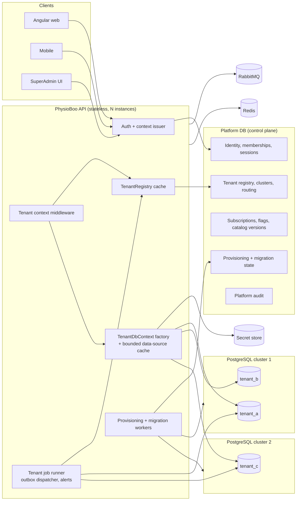
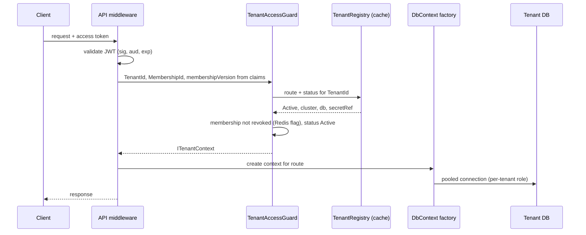
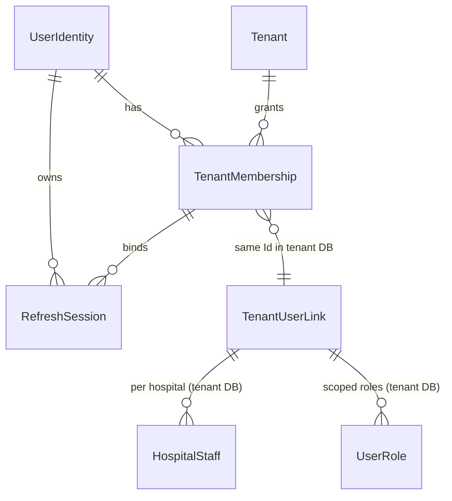
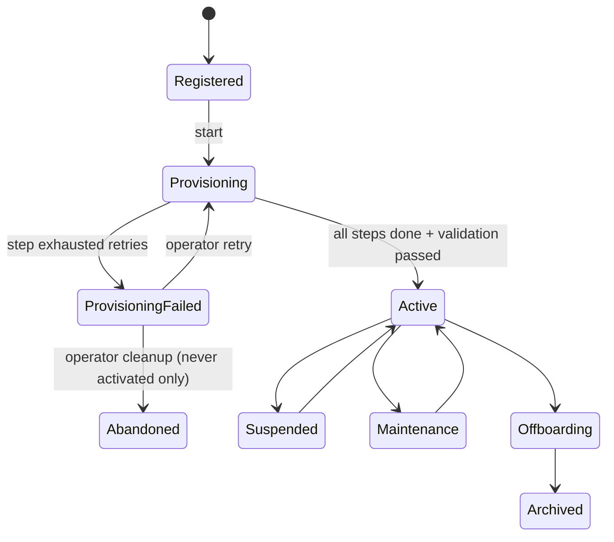

# Multi-Tenant Database Redesign

Status: **design for review. No code, entity, DbContext, migration or database has been changed.**
Companions: `master-data-redesign.md` (catalog ownership and sync), `implementation-roadmap.md` (phases, acceptance criteria, approval gates).
Supersedes the shared-database assumptions in the previous `master-data-redesign.md` (nullable `TenantId` on catalogs) and the "Hospital is the tenant" note in the earlier assessment.

Verification convention: every statement in §2 and §12 was checked against the source in this repository. Items marked **(not verified)** were not found or not inspected.

---

## 0. Confirmed inputs

1. PhysioBoo has no production hospitals. No production data is migrated.
2. One person may work at several hospitals, branches or hospital groups.
3. The PostgreSQL hosting provider is not chosen. The design is provider-neutral.
4. Backend and database work is authorized for this redesign (scoped amendment in `CLAUDE.md`).
5. Target: about 500 tenants, no dedicated server per tenant.
6. This deliverable is documentation and a reviewed plan only.

---

## 1. Architecture decision record

**ADR-001 — Database-per-tenant on shared PostgreSQL clusters, with a Platform Database.**

| | A. Shared DB + TenantId (today) | **B. Database-per-tenant, shared clusters (chosen)** | C. Dedicated cluster per tenant |
|---|---|---|---|
| Isolation | Logical. One missed filter leaks patient data. | Separate database, role and credential per tenant. | Strongest |
| Schema versioning and rollback per tenant | Impossible | Yes | Yes |
| Tenant restore, export, offboarding | Row extraction | Dump or PITR one database | Easy |
| Noisy neighbor | Severe | Moderate; tenants move between clusters | None |
| Cost at 500 tenants | Lowest | Moderate (about 5 to 10 clusters, provisional) | Very high |
| Operational complexity | Low | Medium (orchestration needed) | High |
| Cross-tenant analytics | Easy | Needs export pipeline | Needs export pipeline |

Decision: **B is the baseline.** Selected tenants may be promoted to a dedicated cluster by changing their routing row (C is an operational tier, not a separate architecture). A is rejected: the code already shows the failure modes (§2.3, §2.4).

Consequences: a platform control plane is required; the connection budget becomes a first-class concern; migrations, jobs and messaging must become tenant-aware; global identity must be separated from tenant data (§5).

Feasibility assessment (the "subject to documented feasibility" condition):
- PostgreSQL handles hundreds of databases per cluster; the limiting factors are connections, memory, WAL/backup volume and autovacuum, not database count (§10).
- EF Core can use one compiled model for all tenant databases (the model is identical), which is cheaper than today's per-tenant model cache key (§2.3).
- Provisioning needs `CREATEDB` and `CREATEROLE`-class privileges on the cluster; managed providers differ here (§9).
- Not feasible without change: cross-database foreign keys and joins. Four areas are affected (identity, geography, roles, subscriptions) and each has an explicit answer below.

---

## 2. Current-state assessment (verified)

### 2.1 Solution

`physio-server`: `Domain`, `Application`, `Infrastructure`, `Presentation` (minimal APIs), `SharedKernel`, `Shared` (integration events), `Proto`/`gRPC`, `ServiceDefaults`, `Application.Test`. .NET 9, EF Core + Npgsql, MediatR, MassTransit + RabbitMQ, Redis (optional), Cloudinary. Frontend `physio-app` (Angular, has `/superadmin/*` routes), `physio-mobile` (Capacitor). Deployment: `compose.yml` (api + web; no Postgres service, uses `host.docker.internal`) and a Presentation `Dockerfile`. **No CI configuration is tracked** (no `.github`, no pipeline file).

### 2.2 What "tenant" means in the code today

The earlier assessment and project notes said `Hospital` is the tenant. **That is wrong.**

- `RegisterTenantCommandHandler` creates a `HospitalGroup` (id = `request.NewId`), then its `Hospital` rows with `SetTenantId(request.NewId)`, the owner `User` with `SetTenantId(request.NewId)`, and a `TenantSubscription` (`HospitalGroupId`).
- `HospitalRepository.CountByHospitalGroupAsync` groups hospitals by `h.TenantId` and treats the key as a hospital group id.
- Therefore **TenantId equals HospitalGroup.Id. A tenant is a hospital group (company). A Hospital is a branch inside that tenant.** There is no separate `Branch` or `Facility` entity; `Hospital` is the branch, with `Department`, `Room`, `Ward`, `Bed`, `WarehouseZone` beneath it.
- `HospitalGroup` and the three `Subscription*` entities derive from `AuditEntity`, not `TenantEntity`.

### 2.3 Tenant isolation mechanism

| Fact | Evidence |
|---|---|
| 99 entities derive from `TenantEntity` (`Guid TenantId`). | `Domain/Entities/TenantEntity.cs`, grep |
| One `ApplicationDbContext` (about 170 `DbSet`s) with one connection string. | `ApplicationDbContext.cs`, `Program.cs` L51 |
| Global query filter `!_user.IsAuthenticated \|\| TenantId == _user.GetTenantId()` (plus soft delete). **Unauthenticated contexts see every tenant.** | `ApplyGlobalFilters<T>` |
| `OnTrackingTenant` overwrites `TenantId` on every added `TenantEntity` with the caller's tenant, and throws when it is `Guid.Empty`. | `ApplicationDbContext.SaveChangesAsync` |
| `SetTenantId(_user.GetTenantId())` is repeated in the Create handlers (dozens of call sites). | grep in `Application/Commands` |
| `TenantModelCacheKeyFactory` keys the EF model cache by `CurrentTenantId`, so EF would compile and cache one model per tenant (about 170 entities each). | `TenantModelCacheKeyFactory.cs` |
| `OnConfiguring` calls `EnableSensitiveDataLogging(true)` unconditionally, so it applies in every environment. | `ApplicationDbContext.OnConfiguring` |
| `IgnoreQueryFilters()` appears 8 times: `InventoryAlertJob` (2), `HospitalRepository` (1), `DevDataService`/`HospitalStructureModule` (5, dev tooling). | grep |
| `CreateHospitalCommandHandler` reads a client-supplied `HospitalGroupId` for the tenant id (L74). The later save-time overwrite neutralizes it for normal callers; the SUPER_ADMIN path (empty `TenantId`) was **not traced**. | handler L74 |

### 2.4 Things that are NOT tenant-scoped today

These derive from `Entity`/`AuditEntity` with no tenant column, so every tenant shares one table:

| Entity | Consequence today |
|---|---|
| `Role`, `UserRole`, `RolePermission`, `Permission` | A role assignment is global: a user holding `ADMIN` holds it everywhere. `get_owner_permission_codes(userId)` is keyed by user only. The function definition was **not found** in the C# migrations or in `physio-server` **(not verified where it lives)**. |
| `Sys_AuditLog` | No tenant column. Audit rows of all tenants share one table. |
| `Sys_SequenceTracker` | One numbering counter shared by all tenants. |
| `PrintTemplate`, `PrintTemplateVersion`, `PrintLog`, `Sys_MediaFile`, `Article`, `Sys_Setting`, `SystemSetting`, `Sys_Device` | Shared across tenants. |
| `MedicalSpecialty`, `LabTest`, `LabTestCategory`, `ImagingModality`, `AppointmentType`, `InsuranceCompany`, `Manufacturer`, `Supplier` | Shared across tenants (the eight "catalogs"). A tenant admin edits rows every tenant sees. |
| `Country`, `City`, `District`, `GeoWard`, `AdminMenu` | Global reference (appropriate). |
| `RefreshToken`, `UserLogin`, `VerificationToken` | Auth data stored in the main database. |

### 2.5 Identity and login (verified)

- `User : TenantEntity` holds email, `PasswordHash`, lockout counters, 2FA fields, verification stamps and a single `TenantId`.
- `LoginUserCommandHandler` looks the user up by identifier (`GetByIdentifierAsync`) with no tenant known, issues a JWT with claims `Email`, `NameIdentifier`, `Name`, `TenantId`. **There is no role claim**; permissions come from `PermissionAuthorizationHandler` (cached 5 min per user id).
- `RefreshTokenCommandHandler` finds the user by the refresh token's user email and re-issues `TenantId = user.TenantId`.
- JWT: HS256, `ValidateLifetime` with `ClockSkew = 0`; dev config sets `ExpiryDurationMinutes = 150` (production value **not verified**). The token is read from the `access_token` cookie.
- CORS: any origin with credentials (`SetIsOriginAllowed(_ => true)` + `AllowCredentials`). CSRF protection is registered separately.
- `TenantInvite` is a tenant entity; self-registration (`/api/users/register`) historically produced `TenantId = Guid.Empty` (documented in `tenant-onboarding-redesign.md`).
- A user belongs to **exactly one tenant** by construction. The multi-hospital requirement cannot be met by the current model.
- `HospitalStaff` is per hospital (`HospitalId`, `DepartmentId`, `StaffType`, employment fields) and is a tenant entity; it is the natural organizational assignment.
- SUPER_ADMIN is a role code on a seeded user (`sysadmin@physioboo.com`) whose `TenantId` is the empty guid, backed by a seeded "PhysioBoo Platform" `HospitalGroup` row with the empty guid id (`seed-data.sql`).

### 2.6 Migrations and initialization

- `ApplicationDb` chain: about 60 migrations (Sept 2025 to Jan 2026). Separate chains for `EventStoreDbContext` and `DomainNotificationStoreDbContext`, **all on the same connection string**. Three chains per database would triple orchestration work.
- `Program.cs --seed` calls `DatabaseSeeder.MigrateAsync` and exits. Reference data is loaded by hand with `psql` (`seed-data.sql`, `seed-geography.sql`); C# seeds nothing (`database-seeding.md`).
- `DbContextExtension.EnsureMigrationsApplied` exists (calls `Migrate()`); its call sites were **not traced**. It must never run at startup against tenant databases.

### 2.7 Background work (verified)

| Component | Type | Tenant context today |
|---|---|---|
| `OutboxProcessor` (`BackgroundService`, 10 s poll, batch 20) | hosted | None. Reads the single `OutboxMessages` table through `ApplicationDbContext` with no user, so the filter is bypassed. Integration events carry **no TenantId** (none in `PhysioBoo.Shared`). |
| `InventoryAlertJob` | hosted | `IgnoreQueryFilters()` over all tenants; alerts "keep their batch's tenant". |
| `CloudinaryCleanupJob` (daily) | hosted | Platform-wide (one Cloudinary account). No DB access. |
| `WarmupConnection` | hosted | Touches `ApplicationDbContext` and both store contexts at startup. |
| 11 MassTransit consumers (+ `FanoutEventConsumer`) | consumers | Run with no HTTP user; filters bypassed; tenant is only implicit in the aggregate ids. |
| Event store (`StoredDomainEvents`), notification store | EF contexts | One shared store; records user email and correlation id. |

### 2.8 Authorization surface

- 539 `RequireAuthorization` usages across endpoints; the only endpoint file without one is `DevEnpoints.cs`, which is mapped only in Development.
- `SecurityGuardMiddleware` applies an IP whitelist to paths starting with the segment `/api/admin`. The only route beginning `api/admin` is `api/admin-menus` (a different segment), so **the whitelist protects no route today**. Platform endpoints are guarded by permissions only.

### 2.9 Tests and CI

`PhysioBoo.Application.Test` contains command-handler and validation tests for ten catalog commands. There are no integration, isolation, routing or migration tests, and no CI.

---

## 3. Target architecture

### 3.1 SaaS tenant versus organizational unit

| Concept | Definition | Isolation boundary | Examples |
|---|---|---|---|
| **SaaS tenant** | A customer organization that subscribes to the platform. Maps 1:1 to today's `HospitalGroup`. | **One database** | "Sunrise Health Group" |
| **Organizational unit** | A subdivision inside a tenant: hospital (branch), department, room, ward, warehouse zone. | **Row-level scope inside the tenant database** (`HospitalId` columns) | "Sunrise Riverside Hospital" |

- A single-hospital customer is a tenant with one `Hospital`.
- A hospital group with 30 branches is **one** tenant with 30 `Hospital` rows. Branches are never separate databases unless the customer is contractually separate (then they are separate tenants and users reach both through two memberships).
- The tenant database holds exactly one `HospitalGroup` row (the tenant profile). It is kept so existing relations (`User.HospitalGroup`, `HospitalStaff.HospitalGroup`) stay valid.
- Organizational scoping (hospital-level permissions and data) remains a runtime concern of the application and is **not** replaced by the database boundary (§5.5).

### 3.2 Component diagram

### 3.3 Platform database versus tenant database

| Owned by the **Platform DB** (`PlatformDbContext`) | Owned by each **Tenant DB** (`TenantDbContext`) |
|---|---|
| `Tenant`, `DatabaseCluster`, `TenantDatabase` (routing), lifecycle status | Tenant profile (`HospitalGroup`, 1 row), `Hospital`, `Department`, `Room`, `Ward`, `Bed`, `WarehouseZone` |
| `TenantProvisioningRun`/`Step`, `TenantMigrationState`, `MigrationRun` | Patients, encounters, records, prescriptions, lab, imaging, nursing, surgery, inpatient |
| `TenantSubscription`, `SubscriptionPlan`, `SubscriptionInvoice` (moved out of the tenant model) | Billing, payments, retail, inventory, insurance claims |
| `FeatureFlag`, `TenantFeatureFlag` | Tenant-owned catalogs and local copies of global catalogs (`master-data-redesign.md`) |
| **Identity:** `UserIdentity`, `UserIdentityLogin` (OAuth), `VerificationToken`, `RefreshSession`, `TenantMembership`, `TenantInvite` | **Tenant user profile** `User` (id = `UserIdentity.Id`), `Doctor`, `Patient`, `Profile`, `HospitalStaff`, `UserPreference` |
| **Platform authz:** `PlatformRole`, `PlatformPermission`, `PlatformUserRole` (SUPER_ADMIN, support, billing) | **Tenant authz:** `Role`, `Permission` (copy), `RolePermission`, `UserRole` (with optional `HospitalId`) |
| `GlobalCatalogVersion`, global catalog source tables | `CatalogSyncState`, `CatalogSyncConflict` |
| `Sys_AppVersion`, `Sys_Language`/`Sys_Resource` (platform-owned) | `Sys_Setting`, `Sys_SequenceTracker`, `PrintTemplate*`, `Sys_MediaFile`, `HomeSetting`, CMS |
| `PlatformAuditLog`, `AdminAccessGrant` (break-glass) | **Tenant audit log** `Sys_AuditLog`, event store, notification store, **outbox** |
| Platform outbox (identity and tenant-lifecycle events) | Tenant outbox (clinical and operational events) |

Rule: the Platform DB never stores clinical data. The tenant DB never stores credentials of other tenants or global identity secrets.

### 3.4 `TenantId` inside the tenant database

Default (decision D-02): **remove** the `TenantId` column and the tenant query filter from the 99 entities when the tenant baseline is generated; soft-delete filtering stays. A column that holds one constant value per database is misleading and invites code that "filters by tenant" and gives a false sense of safety. Because there is no production data, the baseline can be regenerated instead of altered. To keep the diff reviewable, the work is staged: routing first (the filter is already redundant once the context points at a single tenant database), the mechanical removal afterwards (roadmap phase 4b). Organizational scopes (`HospitalId`, `DepartmentId`) are preserved.

---

## 4. Tenant database routing

### 4.1 Rules

1. The tenant is resolved only from the validated access token and trusted membership data (§5). Route values, query strings, request bodies and headers named like a tenant are ignored.
2. The Platform DB holds routing metadata only. Credentials are **never** stored in registry rows; rows hold a `SecretRef` that an `ISecretStore` resolves.
3. Application code never sees a connection string. It receives a `TenantDbContext` already bound to one tenant.
4. Relocation changes a routing row only; no business code changes.

### 4.2 Components (proposed names)

| Component | Lifetime | Responsibility |
|---|---|---|
| `ITenantContext` | scoped | Immutable `{TenantId, HospitalId?, MembershipId, UserIdentityId, IsPlatformScope}` built once by middleware from the principal. Setter is internal to the middleware; background code creates one explicitly through the runner. |
| `ITenantRegistry` | singleton | `GetRouteAsync(tenantId)` returns `{Status, Cluster, Database, SecretRef, RoutingVersion}`. Memory cache (TTL 30 to 60 s) + Redis pub/sub invalidation on routing/status change. Cache key is the tenant id only. |
| `ISecretStore` | singleton | Resolves `SecretRef` to a credential. Implementations: environment/file (development), vault or cloud secret manager (production, chosen with the hosting decision). Short in-memory TTL; supports two active versions during rotation. |
| `ITenantDataSourceCache` | singleton | Holds one `NpgsqlDataSource` per `(cluster, database, role)` with a **hard cap** and idle eviction (§10.3). Disposes evicted sources. |
| `ITenantDbContextFactory` | singleton | Creates `TenantDbContext` from the route + data source. `TenantDbContext` receives its connection **in its constructor**; it never reads ambient state afterwards. |
| `TenantAccessGuard` | scoped | Checks tenant `Status` and membership revocation (§5.7) before the first database call. |
| `ITenantScopeRunner` | singleton | Runs background work for one tenant: builds a context, a scope, a correlation id, and structured log scope. |

### 4.3 Request flow

Failure responses: unknown/disabled tenant or revoked membership returns 403 with a generic body (no tenant existence leak); `Maintenance` returns 503 with `Retry-After`.

### 4.4 Stale-state guarantees (cannot use another tenant's connection)

- `TenantDbContext` is constructed per scope from an immutable route; there is no mutable "current tenant" field to go stale.
- The registry cache key and the data-source cache key both include the database identity. A test fixture runs two tenants concurrently and asserts each context's `current_database()` equals its route (roadmap acceptance, phase 4).
- The EF model is identical for all tenants, so `TenantModelCacheKeyFactory` is deleted and `IModelCacheKeyFactory` stays default. Eliminating the per-tenant model cache removes a memory risk at 500 tenants.
- `ApplicationDbContext` must not be injected into singletons or hosted services; only the factory/runner is allowed there (enforced by an architecture test).
- A guard in `SaveChangesAsync` rejects writes when the context has no tenant binding (replaces `OnTrackingTenant`'s empty-guid throw).

### 4.5 Relocation

1. Mark `TenantDatabase` row A `ReadOnly`, tenant `Maintenance`.
2. Copy to the target cluster (`pg_dump`/restore, or physical/logical replication for large tenants).
3. Verify schema version and row counts; create row B (`Ready`).
4. Atomically flip the primary pointer; bump `RoutingVersion`; publish invalidation.
5. Keep A read-only for the retention window, then retire.

---

## 5. Identity and multi-hospital membership

### 5.1 Principles

- Identity is **global**. Authority is **per membership**. An email address never implies a tenant.
- A token always carries exactly one working context: one tenant and at most one hospital.
- Nothing the client sends (claim edits, header, query) can widen that context; every context is minted by the server from membership data.

### 5.2 Model

**Platform DB**

| Entity | Key fields | Notes |
|---|---|---|
| `UserIdentity` | `Id`, `Email`, `EmailNormalized` (unique), `Phone`, `PasswordHash`, `IsActive`, `EmailVerifiedAt`, lockout fields, 2FA fields, `PreferredLanguage`, `TimeZone` | Credentials and security state move here from `User`. Unique index on normalized email. |
| `UserIdentityLogin` | provider, provider key | Replaces `UserLogin` (OAuth). |
| `TenantMembership` | `Id`, `UserIdentityId`, `TenantId`, `Kind` (Owner, Staff, Doctor, Patient), `Status` (Invited, Active, Suspended, Revoked), `MembershipVersion`, `DefaultHospitalId?`, timestamps | Unique `(UserIdentityId, TenantId)`. `MembershipVersion` increments on any change that affects access. |
| `RefreshSession` | `Id`, `FamilyId`, `UserIdentityId`, `TenantId`, `MembershipId`, `HospitalId?`, `TokenHash`, `ExpiresAt`, `RevokedAt`, device info | Replaces `RefreshToken`. Stores a **hash**, never the raw token. Bound to one context. |
| `TenantInvite` | `TokenHash`, `TenantId`, `Email`, role codes, `HospitalId?`, expiry | Lives in platform because an invitee has no membership yet and the token must find the tenant. |
| `PlatformRole` / `PlatformUserRole` | | SUPER_ADMIN, support, billing. Separate from tenant roles. |

**Tenant DB**

| Entity | Notes |
|---|---|
| `User` | Tenant-local profile. `Id` equals `UserIdentity.Id` (no cross-database FK; integrity maintained by the membership workflow). Keeps all existing FKs (`Doctor`, `Patient`, `Profile`, `HospitalStaff`, audit `CreatedBy`). Password, lockout, 2FA columns are removed from it. |
| `HospitalStaff` (existing) | The **organizational assignment**: which hospital(s) and department(s) the person works in, with `EmploymentStatus`. One row per person per hospital. |
| `Role`, `RolePermission`, `UserRole` | Tenant-local. `UserRole` gains an optional `HospitalId` (null = whole tenant). System roles seeded from the platform catalog and locked; tenants may add custom roles. |

Reused rather than invented: `User`, `HospitalStaff`, `Role`, `UserRole`, `TenantInvite`, `RefreshToken`/`UserLogin`/`VerificationToken` (relocated). New: `UserIdentity`, `TenantMembership`, `RefreshSession`, platform role tables.

Patients: a person receiving care is a membership of kind `Patient` plus a tenant-local `Patient` row. Clinical data stays in each tenant; nothing is shared across tenants without a separately designed consent feature (out of scope).

### 5.3 Login and context selection

1. `POST /api/auth/login` verifies credentials against `UserIdentity` (lockout, verification, 2FA all here).
2. The server loads active `TenantMembership` rows and the tenants' `Active` status.
3. - **0 memberships:** a limited token (audience `physioboo-account`) allowing profile and invite acceptance only.
   - **1 membership:** the server may auto-select it (hospital step below) and return an access token.
   - **More than 1:** return a short-lived **selection token** (5 minutes, audience `physioboo-ctx`, usable only on the context endpoint) plus the membership list (tenant id, name, kind).
4. `POST /api/auth/context` `{tenantId, hospitalId?}` with the selection token. The server verifies the membership is `Active` and the tenant is `Active` (Platform DB), then loads the person's `HospitalStaff` assignments from the **tenant DB** to validate `hospitalId` (or auto-select when there is exactly one; when several exist and none is chosen it returns the list so the UI can ask).
5. The server issues the **access token** (audience `physioboo-api`) and a `RefreshSession` bound to that context.

Access token claims: `NameIdentifier` (= `UserIdentity.Id`), `Email`, `TenantId` (kept name, now only minted from a verified membership), `HospitalId?`, `MembershipId`, `mv` (membership version), `sid` (session id). No role/permission claims (consistent with today); permissions are resolved per request from tenant data and cached by `(tenantId, userId, hospitalId)`.

Platform administrators receive a token with audience `physioboo-platform` and **no** tenant claim. Tenant endpoints reject it; platform endpoints reject tenant tokens. There is no shared "empty guid tenant".

### 5.4 Switching hospitals and tenants

- **Switch hospital inside the tenant:** `POST /api/auth/switch-context` with the current access token and a new `hospitalId`; the server re-checks `HospitalStaff` and issues a new access token and rotates the refresh session. No re-authentication.
- **Switch tenant:** same endpoint with a different `tenantId`; the server re-checks membership and tenant status. The old context's refresh session is revoked. A user may keep several sessions on different devices; each is bound to one context.
- Switching never edits the existing token; it always mints a new one.

### 5.5 Users across several branches in one tenant

A user with several `HospitalStaff` rows has one tenant membership and an **active hospital** claim. Hospital-scoped data access uses that claim; a user who needs a cross-branch view holds a tenant-wide `UserRole` (`HospitalId = null`) with explicit permissions. Permission evaluation is `(permission, hospitalId)`: a role assignment applies when its `HospitalId` is null or equals the active hospital. Cache key includes `hospitalId`.

### 5.6 Refresh tokens

Rotating, single use, one family per login. Reuse of a revoked token revokes the whole family. On each refresh the server re-validates: session not revoked, membership `Active` with the same or higher `MembershipVersion`, tenant `Active`, hospital assignment still present (when `HospitalId` is set). Defaults: access token **10 minutes** (today's dev value is 150), refresh token 14 days absolute, 7 days idle. Expiry values are decision D-06.

### 5.7 Revocation and disabling a membership

| Event | Effect |
|---|---|
| Membership suspended or revoked | Status + `MembershipVersion` change in Platform DB; all `RefreshSession` rows for it revoked; Redis key `revoked:membership:{id}` set (the existing `ban_user_{userId}` check in `SecurityGuardMiddleware` is the pattern to follow). Access tokens are rejected at the next request. |
| Hospital assignment removed | `HospitalStaff`/`UserRole` change invalidates the permission cache for the user; the refresh path re-checks assignment. A still-valid access token for that hospital loses its permissions on the next permission lookup (cache TTL at most 60 s in this design). |
| Tenant suspended | Registry status flips and invalidation is published; every request for the tenant is refused within the cache TTL (target 60 s, lower with pub/sub). |
| Identity disabled or password reset | All sessions of the identity revoked. |
| Tenant offboarding | All memberships to the tenant revoked; database retired per §11. |

Worst-case exposure after a revocation is one access-token lifetime when the Redis check is unavailable (fail-closed is configurable; default fail-closed for revocation lookups).

### 5.8 Support access (break glass)

SUPER_ADMIN cannot read tenant data through ordinary routes. Support access is a time-boxed `AdminAccessGrant` (reason, ticket id, scope read-only by default, maximum 4 hours, optional approval by a second administrator). It yields a token with an `imp` claim naming the grant; every request under it is written to both the tenant audit log and the platform audit log. Default decision D-08.

### 5.9 Registration and invites

- Public registration creates a `UserIdentity` only (fixes the `TenantId = Guid.Empty` defect structurally).
- `RegisterTenant` creates the tenant record and starts provisioning (§6); the owner identity gets an `Owner` membership when provisioning succeeds.
- Invites: the tenant admin creates a platform `TenantInvite`; acceptance by an authenticated identity (or after signup) creates the membership, then the tenant-side `User`, `HospitalStaff` and `UserRole` rows through the tenant database, as one retryable workflow keyed by the invite id.

---

## 6. Tenant provisioning

### 6.1 State machine

### 6.2 Steps (each idempotent; each recorded in `TenantProvisioningStep`)

| # | Step | Idempotency rule |
|---|---|---|
| 1 | Register tenant | Unique tenant code/slug and a client idempotency key; second call returns the same tenant. |
| 2 | Allocate cluster | Choose an `Open` cluster with capacity; record `TenantDatabase(State = Provisioning)`; a retry reuses the recorded cluster. |
| 3 | Create database + roles | `CREATE DATABASE` only if absent; create `tenant_<id>_app` (DML) and `tenant_<id>_migrator` (DDL) roles if absent; `REVOKE CONNECT ... FROM PUBLIC`; store the secret and write the `SecretRef`. |
| 4 | Apply migrations | `Migrate()` is itself idempotent. Runs with the migrator role, never at HTTP startup. |
| 5 | Seed global reference data | Insert-if-missing keyed by `SourceId`; records `CatalogSyncState` versions. |
| 6 | Seed tenant configuration | Tenant profile, hospitals from the signup form, system roles, starter appointment types, sequence rules, settings; upserts on natural keys. |
| 7 | Initial memberships | Create the owner `User`, `UserRole` and `Owner` membership. |
| 8 | Validate | Connectivity as the app role; `__EFMigrationsHistory` equals the target; required seed counts; the app role cannot run DDL; a write/read round trip. |
| 9 | Activate | Single transaction: `Tenant.Status = Active`, `TenantDatabase.State = Ready`. Only reachable if steps 1 to 8 are `Succeeded`. |

### 6.3 Failure handling and cleanup

- Provisioning runs in a background worker (queue message + `TenantProvisioningRun` row with a lease), never inside the HTTP request that triggered it. The API returns `202` with a status URL.
- Each step records attempt count, error, duration. Transient errors retry with backoff; exhausted retries move the run to `ProvisioningFailed` and raise an alert.
- **Cleanup restriction:** a database may be dropped only when the tenant has never reached `Active`, the operator confirms, and the database name matches the recorded `TenantDatabase` row (names are generated, never user-supplied). A tenant that has been `Active` is never auto-cleaned.
- Partial runs are resumable because each step first checks its own post-condition.
- Observability: step durations, failure counts, queue depth, time-to-active metrics; platform audit entries for every transition with actor.

### 6.4 Optional optimization

`CREATE DATABASE ... TEMPLATE` from a pre-seeded template database makes steps 4 and 5 near-instant. It needs exclusive access to the template and may be restricted by some managed providers, so it sits behind the provisioner interface and is not the baseline.

---

## 7. Migrations and version management

### 7.1 Three separate versions

| Version | Meaning | Where tracked |
|---|---|---|
| **Application version** | The deployed API build | build metadata, `Sys_AppVersion` |
| **Schema version** | Last applied migration id per database (tenant and platform) | `TenantDatabase.SchemaVersion`, EF history table |
| **Catalog version** | Version of each global catalog applied to a tenant | `TenantCatalogVersion` / tenant `CatalogSyncState` |

They are never assumed equal. A release declares `MinSchema` and `MaxSchema` it can run against.

### 7.2 Chains

- **Platform chain:** its own `PlatformDbContext` migrations, applied by the deployment pipeline before the API rolls out.
- **Tenant chain:** one `TenantDbContext` chain (the store contexts are folded in, D-11), applied by the orchestrator.
- **Baseline:** because there is no production data, the existing 60 `ApplicationDb` migrations and the two store chains are replaced by a fresh baseline per chain when the model is split. Old chains are archived in git history, not deleted from it.
- If the development database holds data worth keeping: take `pg_dump` before any later phase; reference data is rebuilt from the seed SQL and the dev-data generator (`api/dev-data/*`); this plan does not touch the dev database.

### 7.3 Orchestration

`MigrationOrchestrator` (hosted worker or CLI job; never request-time):
- Input: target schema version, **cohorts** (internal, pilot, general) and a concurrency cap (default 4, configurable per cluster).
- Per tenant: pre-flight (tenant `Active` or `Maintenance`, backup/restore point confirmed, cluster headroom) then take a per-database advisory lock, apply with the migrator role, post-migration health check (history table, key table probes, app-role smoke query), record `TenantMigrationState`.
- A failure marks that tenant `MigrationFailed`, stops its cohort when the failure rate exceeds a threshold, and never blocks other tenants.
- Reporting: platform page listing tenants by schema version, status and last error; query for tenants outside the supported range.

### 7.4 Compatibility and release rules

- **Expand and contract.** Release N adds nullable columns/tables (expand) and keeps reading old shapes; release N+1 removes old shapes (contract) only after every tenant reached the expanded schema. Destructive steps are separate migrations behind an explicit approval and never run in the same deployment as the code that stops using them.
- Compatibility check at startup and per request: the API reads the tenant's `SchemaVersion` from the registry; outside `[MinSchema, MaxSchema]` the tenant is served `503 (schema not supported)` or placed in `Maintenance`, not run blindly.
- Rolling deployment: old and new API instances coexist, so each release must work with the schema before and after the pending migration (that is what expand/contract guarantees).
- Failure recovery is **roll-forward**: fix migration, re-run for failed tenants; restore from backup only for data corruption. No automatic down-migrations.
- No migration runs during application startup. `DatabaseSeeder.MigrateAsync` and `EnsureMigrationsApplied` are removed from tenant paths.
- Feature flags control exposure, never schema compatibility.

---

## 8. Background jobs and messaging

### 8.1 Inventory and target classification

| Component | Today | Target scope | How it finds tenants | Context | Failure isolation | Concurrency |
|---|---|---|---|---|---|---|
| `OutboxProcessor` | one table, no tenant | **Per-tenant outbox in each tenant DB**, drained by one `TenantOutboxDispatcher` | active tenants from the registry, fair round-robin, skip `Maintenance` | `ITenantScopeRunner` per tenant | per-tenant try/catch; retry count per message; poison messages go to a dead-letter status, tenant keeps draining | parallelism cap (default 4); batch 20 per tenant per cycle |
| Platform outbox | n/a | Platform DB outbox for identity/tenant-lifecycle events | n/a | platform scope | same | 1 worker |
| `InventoryAlertJob` | `IgnoreQueryFilters` over everyone | **Tenant-scoped job** | registry iteration | runner | per-tenant; results recorded | cap 4; stagger |
| `CloudinaryCleanupJob` | platform-wide | **Platform-scoped** (no tenant DB) | n/a | none | n/a | 1 |
| `WarmupConnection` | warms 3 contexts | Warm the registry and Platform DB only; optionally the model once; never open all tenant databases | n/a | none | n/a | n/a |
| MassTransit consumers (11 + fanout) | no tenant | **Tenant-scoped via a consume filter** | `x-tenant-id` header set by the publisher | filter builds `ITenantContext` | failed consume retries then `_error` queue; one tenant's poison does not block others when the message carries tenant id | prefetch limit per consumer |
| Event store | shared | tenant DB (`StoredDomainEvents`) | n/a | by context | n/a | n/a |
| Notification store | shared | tenant DB with retention (default 30 days) | n/a | by context | n/a | n/a |

### 8.2 Messaging rules

- Every integration event gains a `TenantId` in the message envelope and the `x-tenant-id` transport header, written by the outbox dispatcher from the tenant being drained. Events carry no tenant-choosing power beyond identifying the already-authorized source: the consume filter validates that the tenant exists and is `Active`.
- A consumer without a tenant id (platform events) runs in platform scope. A tenant consumer that finds no context fails fast; it never falls back to "no filter".
- Idempotency: consumers record a processed-message id in the tenant DB (or use naturally idempotent writes). Outbox rows already carry `RetryCount` and `Error`; add a dead-letter state and an alert on count.
- Avoid one hosted service per tenant. Fixed small set of workers iterating tenants with bounded parallelism.
- Cloudinary: tenant media paths use a `tenants/{tenantId}/` public-id prefix so a later tenant export or delete is possible; the cleanup tag stays platform-wide.

---

## 9. PostgreSQL hosting (provider-neutral)

### 9.1 Comparison

| Concern | Managed PostgreSQL | Self-hosted PostgreSQL |
|---|---|---|
| Provisioning (`CREATE DATABASE`, roles) | Possible, but the admin role is a restricted "almost superuser"; role creation and `CREATE DATABASE ... TEMPLATE` may be limited. Needs API or SQL path per provider. | Full control with a real superuser; scripts and Ansible/Terraform you own. |
| Secrets | Provider secret manager + IAM integrations | Vault or equivalent you operate |
| Backups and PITR | Built in, usually per **instance**; per-database restore means restore-to-new-instance then dump that database | Your own pgBackRest/WAL-G; per-database logical dumps are easy; PITR restore is per cluster |
| Tenant-specific restore | Restore instance to a point in time elsewhere, extract the tenant database, reload | Same procedure; more flexibility |
| High availability | Provider replicas/failover | Patroni (or similar); you operate and test it |
| Monitoring | Provider metrics + `pg_stat_*` | Prometheus/Grafana/exporters you run |
| Database relocation | Dump/restore or logical replication between instances | Same, plus physical options |
| Migration orchestration | Identical (it is application-side) | Identical |
| Operational workload | Lowest | Highest (patching, failover, capacity) |
| Cost | Higher per GB and connection | Lower hardware cost, higher staff cost |

### 9.2 Provider-neutral abstractions

- `IDatabaseClusterProvisioner`: `EnsureDatabaseAsync`, `EnsureRolesAsync`, `DropDatabaseAsync` (guarded), `GetCapacityAsync`. Initial implementation uses plain SQL over an admin connection, which works on both options; provider-specific implementations are added only after the hosting decision.
- `ISecretStore`: environment/file in development; the production implementation is selected with hosting.
- `IClusterAllocator`: picks a cluster by `Status`, `MaxDatabases`, connection budget, tier and region.
- No cloud SDK dependencies in this redesign.

### 9.3 Minimum requirements whichever option is chosen

1. TLS in transit; storage encryption at rest.
2. Automated backups with **point-in-time recovery** and a documented, rehearsed restore of a single tenant database.
3. Secrets in a secret manager, rotatable without downtime.
4. A way to create databases and roles programmatically with least-privilege admin credentials kept out of the API process where possible (admin secret used by the provisioning worker only).
5. Monitoring and alerting on connections, replication lag, disk, long transactions, autovacuum and failed backups.
6. A failover story with a tested RTO.
7. Per-cluster connection limit documented and enforced by the budget in §10.
8. Maintenance windows and version-upgrade procedure.

---

## 10. Capacity planning for 500 tenants (provisional)

### 10.1 Separation of confirmed versus assumed

| Confirmed decisions | Assumptions that need load testing |
|---|---|
| Database per tenant on shared clusters | Databases per cluster (planning range 50 to 100; **not** a fixed rule) |
| Dedicated cluster is an upgrade path, not the default | Cluster size (vCPU/RAM/IOPS) |
| Bounded, evictable data-source cache | Per-tenant pool size (planning value 5) |
| Per-cluster connection budget | Whether an external pooler (PgBouncer-class) is needed |
| One compiled EF model for all tenants | Number of simultaneously active tenants per API instance |

### 10.2 Workload inputs still needed

Concurrent users per tenant (and the distribution: median versus largest tenant); peak requests per second; initial database size and growth per month (records, images/attachments stored outside the DB); connection concurrency per request; background job volume (outbox rate, alerts); availability target; RPO; RTO; regulatory retention and residency constraints; number of API instances.

### 10.3 Connection budget

Npgsql pools per distinct connection string, so every active tenant database has its own pool in every API instance. Budget per cluster:

`API instances × (active tenant pools on that cluster) × MaxPoolSize ≤ 0.8 × max_connections − reserved (admin, replication, migrations)`

Illustration only (not a sizing): 4 instances × 30 active tenants × pool 5 = 600 connections, which already exceeds a typical `max_connections` of 200 to 500. Consequences:

- Per-tenant `MaxPoolSize` stays small (planning 3 to 5), `MinPoolSize = 0`, short `ConnectionIdleLifetime`, and a **global cap on open data sources** with LRU eviction (dispose the idle ones).
- A semaphore limits concurrent tenant database work per instance.
- If the numbers do not fit, add a transaction-mode pooler in front of each cluster. Verify Npgsql compatibility (no session state assumptions, prepared-statement settings, `No Reset On Close`). This decision waits for load tests.
- Migration and provisioning workers use their own small pool and run under the migrator role.

### 10.4 Allocation, noisy neighbors, promotion

- New tenants go to the cluster with the most headroom in a **tier** (standard, high-availability, dedicated) and region.
- Track per-tenant database size, connection use, slow queries and `pg_stat_statements` share. Alert when a tenant exceeds a share threshold.
- Mitigations in order: rate limits and query timeouts (`CommandTimeout` already 30 s), per-role `statement_timeout`/connection limit (`ALTER ROLE ... CONNECTION LIMIT`), move the tenant to a quieter cluster, then a dedicated cluster.
- Backup/WAL volume and autovacuum scale with total data, not database count; size storage for the sum plus growth.

---

## 11. Security model

### 11.1 Controls

| Control | Design |
|---|---|
| Tenant isolation | Separate database per tenant, `REVOKE CONNECT ... FROM PUBLIC`, per-tenant app role. **Honest limit:** the API process can resolve credentials for every tenant it serves, so a routing bug in that process could still reach the wrong database. Mitigations: immutable context, no ambient state, concurrent-isolation tests, per-tenant roles so a leaked single secret exposes one tenant, per-request `current_database()` assertion in non-production test runs. |
| Least privilege | `tenant_<id>_app`: DML only, no DDL, read-only on immutable catalog tables. `tenant_<id>_migrator`: DDL, used by the orchestrator only. Platform roles separated. Provisioning admin credential only in the provisioning worker. |
| Secrets | `SecretRef` in the registry; secrets in a store; two-version rotation; never in logs or docs. |
| Transport and storage | TLS to PostgreSQL (`SSL Mode=VerifyFull`), encrypted storage, encrypted backups. |
| Auth | Audience separation (`api`, `platform`, `ctx`, `account`), 10 minute access tokens, rotating hashed refresh tokens, immediate revocation flags, `MembershipVersion`. |
| Admin access | Platform endpoints require platform audience + permission; IP allow-list applied to the real platform route prefix; break-glass grants (§5.8). |
| Auditing | Tenant audit log inside each tenant DB (fixes the shared `Sys_AuditLog`); platform audit log for provisioning, membership, support access, catalog publication. Audit rows append-only for the app role. |
| Safe deletion | Offboarding: suspend, export on request, retention hold (default 90 days, legal review), then drop database via the guarded provisioner with a second approver and a verified final backup. |
| Retention | Clinical records follow the customer's contract and local health-record law (**to be confirmed with legal**); soft delete never cascades into clinical data (`DeleteBehavior.Restrict` is already applied globally). |
| Backups | Encrypted, access-controlled, restore-tested per tenant on a schedule; restore verification recorded. |
| Historical references | Catalog rows referenced by clinical data are never deleted; deactivation only (`master-data-redesign.md`). |

### 11.2 Existing findings (verified) and remediation

| # | Finding | Severity | Remediation | Phase |
|---|---|---|---|---|
| S1 | `EnableSensitiveDataLogging(true)` is forced in `OnConfiguring`, so parameter values (patient data) may be logged in every environment. | High | Remove from `OnConfiguring`; keep it only under the existing Development block. | 4 |
| S2 | Query filter bypass when `!IsAuthenticated`; consumers and jobs run unauthenticated and see all tenants. | High | Removed by design: no ambient filter; tenant context mandatory; background code through `ITenantScopeRunner`. | 4, 7 |
| S3 | Roles, permissions and user-role assignments are global; `get_owner_permission_codes(userId)` is not tenant aware. | High | Tenant-local authz; platform roles separate (§5.2). | 2 |
| S4 | `Sys_AuditLog`, `Sys_SequenceTracker`, `PrintTemplate`, `Sys_MediaFile`, `Article` have no tenant column. | High | Move into tenant DB. | 4, 6 |
| S5 | The eight catalogs are shared and editable by any tenant admin. | Medium | Ownership matrix. | 6 |
| S6 | `SecurityGuardMiddleware` whitelist matches `/api/admin` only and protects no route. | Medium | Apply to the platform route prefix once defined; do not rely on it alone. | 10 |
| S7 | Access token lifetime 150 minutes (dev value; production **not verified**), no revocation path beyond the user ban flag. | Medium | 10 minute tokens, membership revocation flags. | 2 |
| S8 | CORS accepts any origin with credentials; the JWT travels in a cookie. | Medium | Restrict origins to configured clients; keep CSRF protection; verify cookie `SameSite` per environment. | 10 |
| S9 | `seed-data.sql` (committed) creates `sysadmin@physioboo.com` with a documented default password. | Medium | Require a one-time password set at first run; remove the default from committed files for any non-developer environment. | 3 |
| S10 | `appsettings.Development.json` holds an SMTP password and the JWT signing secret in plain text. It is **git-ignored and was never committed** (`git log` over the path and the secret string returned nothing), so the exposure is the developer machine and any copy of the file. | Low to medium | Move secrets to user-secrets or environment variables. **Rotate the SMTP app password and the JWT secret only if the file was ever shared outside this machine.** Rotation steps: issue a new SMTP app password and revoke the old; generate a new 256-bit random `Auth:Secret` (this invalidates all existing tokens); update every environment's secret store. Not performed here. | 3 |
| S11 | `CreateHospitalCommand` accepts a client-supplied `HospitalGroupId`. | Medium | Remove the field; tenant comes from context; SUPER_ADMIN tenant operations go through explicit platform commands. | 2 |
| S12 | No CI, no integration or isolation tests. | Medium | Phase 9 test suite and a CI pipeline gate. | 9 |

No credential value appears in this document.

---

## 12. Trade-offs

- **Operational complexity up, blast radius down.** More moving parts (registry, provisioner, orchestrator) in exchange for per-tenant restore, versioning and isolation.
- **No cross-database FKs.** Identity IDs are linked by convention, enforced by the membership workflow and a periodic reconciliation job; geography and permissions are copied so FKs and joins keep working.
- **Reference data duplication.** About 15k geography rows per tenant (a few MB) is traded for simpler queries and no request-path dependency on the platform database.
- **Analytics need a pipeline.** Cross-tenant reporting is no longer a SQL join; a later, separate decision (export or CDC to a warehouse).
- **Staged removal of `TenantId`.** Keeping the column briefly reduces risk; leaving it permanently adds confusion.

---

## 13. Decisions and recommended defaults

| ID | Decision | Recommended default | Needs input from |
|---|---|---|---|
| D-01 | Tenant unit | Tenant = HospitalGroup; Hospital = organizational unit | Owner (confirm) |
| D-02 | `TenantId` in tenant DB | Remove from entities when the baseline is regenerated | Owner |
| D-03 | Existing migrations/dev DB | Fresh baselines; dev DB is disposable unless the owner says otherwise (dump first) | Owner |
| D-04 | Provisioning method | Migrate + seed (portable); template cloning later | Hosting decision |
| D-05 | Per-tenant DB roles | Yes (app + migrator) | Security review |
| D-06 | Token lifetimes | Access 10 min; refresh 14 days absolute / 7 days idle | Owner, security |
| D-07 | Context model | One tenant + optional hospital per token | Owner |
| D-08 | Support access | Break-glass grants, read-only default, 4 h max | Owner, legal |
| D-09 | Identity location | Platform DB; tenant `User.Id` = `UserIdentity.Id` | Owner |
| D-10 | Roles | Tenant-local roles; platform roles separate | Owner |
| D-11 | Store contexts | Fold event store and notification store into `TenantDbContext`; notification store retention 30 days | Owner |
| D-12 | Outbox | Per-tenant outbox + one dispatcher | none |
| D-13 | `TenantInvite` location | Platform DB | none |
| D-14 | Databases per cluster (planning) | 50 initially, ceiling 100 until load tests | Workload data |
| D-15 | Pooler | Not initially; decide after load tests | Load tests |
| D-16 | Hosting provider | Undecided; use provider-neutral interfaces | Owner |
| D-17 | Retention periods and residency | To be confirmed (legal) | Legal |
| D-18 | Patient cross-tenant sharing | Out of scope | Owner |
| D-19 | Cohorts | internal, pilot, general | Owner |

## 14. Open questions

1. Where is `get_owner_permission_codes` defined, and is it present in the current database only? It must be recreated in the tenant baseline.
2. Does `DbContextExtension.EnsureMigrationsApplied` have any caller? It must not run for tenant databases.
3. What are production token lifetime and production CORS/cookie settings?
4. Are there real customers planned within the first quarter that constrain the hosting decision?
5. Is a single person ever both a staff member and a patient in the same tenant (two memberships of one kind, or one membership with two roles)? Default: one membership, kind chosen by primary role, additional roles via `UserRole`.

## 15. Related documents

`master-data-redesign.md`, `implementation-roadmap.md`, `database-seeding.md` (current seeding, to be reworked per tenant in phase 5), `tenant-onboarding-redesign.md` (signup flow, to be aligned with §6), `superadmin-tenants-redesign.md`, `superadmin-platform-redesign.md`.
